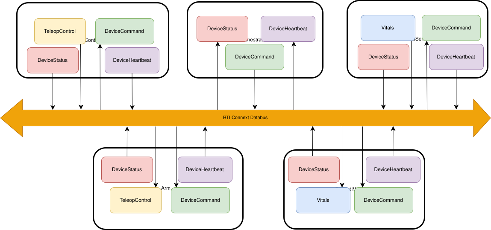

# RTI MedTech Reference Architecture

The Medical Reference Architecture demonstrates RTI's best practices for building medical devices using RTI Connext®.

This repository contains documentation and module demo applications showcasing different capabilities of Connext in a Medical context. The goal is to provide a comprehensive guide to help developers leverage Connext for building robust, scalable, and interoperable medical systems.

## Contents

- [Introduction](#introduction)
- [Quick Start](#quick-start)
- [Hands-On: Modules](#hands-on-modules)
  - [Module 01: Digital Operating Room](#module-01-digital-operating-room)
  - [Module 02: RTI Recording Service & RTI Replay Service](#module-02-rti-recording-service--rti-replay-service)
  - [Module 03: Remote Teleoperation with RTI Real-Time WAN Transport](#module-03-remote-teleoperation-with-rti-real-time-wan-transport)
  - [Module 04: Security Threat Demonstration](#module-04-security-threat-demonstration)
- [Hands-On: Architecture](#hands-on-architecture)
- [Architecture Overview](#architecture-overview)
  - [Data Types](#data-types)
  - [Quality of Service (QoS)](#quality-of-service-qos)
  - [Domains & Topics](#domains--topics)
  - [DomainParticipants & DDS Entities](#domainparticipants--dds-entities)
  - [DDS Security](#dds-security)
- [Going Further](#going-further)
  - [Want to dig deeper?](#want-to-dig-deeper)
- [Additional references](#additional-references)

## Introduction

RTI Connext is a leading connectivity framework designed to facilitate real-time data distribution in distributed systems. In the medical field, it is crucial to have reliable and timely data exchange between various medical devices and systems. This project aims to illustrate how Connext can be used to build a robust Medical Reference Architecture that ensures data interoperability, scalability, and reliability.

By following the examples and best practices outlined in this documentation, architects and developers can find inspiration to create medical applications.

Here are some links that compliment this repository:

- [MedTech Reference Architecture Overview on Youtube](https://www.youtube.com/watch?v=RiFxmO6RAEw).
- [Capability Brief PDF](https://www.rti.com/hubfs/_Collateral/capability-briefs/rti-capability-brief-MedTech-Reference-Architecture.pdf)
- [Case+Code page on rti.com](https://www.rti.com/developers/case-code/medtech-reference-architecture)

## Quick Start

The steps below cover environment setup, dependencies, security artifacts, and building the project. To run anything, follow the module-specific README for the scenario you want to explore.

### 1. Prerequisites

You will need:

- **RTI Connext DDS 7.7.0** installed and `NDDSHOME` set, including the Python API `.whl`.
  See the [Installation Guide](https://community.rti.com/static/documentation/connext-dds/7.7.0/doc/manuals/connext_dds_professional/installation_guide/installation_guide/Installing.htm) and [Python API setup](https://community.rti.com/static/documentation/connext-dds/7.7.0/doc/manuals/connext_dds_professional/getting_started_guide/python/before_python.html#installing-connext-heading).

  > If `NDDSHOME` is not already in your environment, source the platform setup script from your Connext installation: `source <connext_dir>/resource/scripts/rtisetenv_<arch>.bash` (Linux/macOS) or `rtisetenv_<arch>.bat` (Windows). This script sets `NDDSHOME`, `CONNEXTDDS_ARCH`, and related library paths required by both `build.py` and `launch.py`.
- **CMake** ≥ 3.18 and a C++ compiler toolchain.
- **Python** ≥ 3.11.

Install the system build dependencies for your platform:

<details>
<summary><strong>Linux (Debian/Ubuntu)</strong></summary>

```bash
sudo apt install \
    build-essential \
    cmake \
    pkg-config \
    python3-venv
```

> `python3-venv` is required on Debian/Ubuntu to create virtual environments (`python3 -m venv`).
> It is a split package not included with the base `python3` install.

</details>

Browser mode is the default and does not require a desktop GUI toolkit. To
build optional C++ native-webview support on Linux, also install GTK 3 and
WebKitGTK 4.1 development packages:

```bash
sudo apt install libgtk-3-dev libwebkit2gtk-4.1-dev
```

<details>
<summary><strong>macOS</strong></summary>

```bash
xcode-select --install          # compiler toolchain (if not already installed)
brew install cmake pkg-config python3
```

> Homebrew's `python3` includes `pip` and `venv` — no separate installs needed.

</details>

### 2. Clone the Repository

```bash
git clone https://github.com/rticommunity/rticonnextdds-medtech-reference-architecture.git
cd rticonnextdds-medtech-reference-architecture
```

### 3. Set Up a Python Virtual Environment

```bash
python3 -m venv .venv
source .venv/bin/activate          # Windows: .venv\Scripts\activate
python -m pip install uv==0.13.8
uv sync --active --locked --inexact --no-dev --extra user

# Install the RTI Connext Python API from your local Connext installation:
python -m pip install --no-index --find-links "$NDDSHOME/resource/python_api" \
  rti.connext.activated==7.7.0
# Alternatively, if the above path is not available, install from PyPI:
# python -m pip install rti.connext==7.7.0
```

[`pyproject.toml`](./pyproject.toml) defines capability and persona extras;
[`uv.lock`](./uv.lock) records resolved dependencies across platforms. The
`user` persona includes the Arm simulation and gamepad capabilities. Use
`--extra arm` instead for the Arm without the gamepad, or omit the extra for
the base dependencies only. The externally supplied Connext API is not in the
lock. Always use `--inexact` when syncing an environment that contains it:
uv's default exact sync removes packages not selected by the lock. `--locked`
rejects an out-of-date lock rather than updating it. The lock does not pin the
Connext installation, system libraries, compiler, or all build-tool dependencies.

Optional Python native-webview mode can be installed separately with
`uv sync --active --locked --inexact --no-dev --extra user --extra native`.
Browser mode does not need this companion package. The embedded native window hosts the same web frontend;
review the SDK's [native-webview support matrix and platform prerequisites](https://wcoleman-rti.github.io/rti-demo-ui/native-webview.html)
before enabling it on a target platform.

The simulated Arm uses MuJoCo and Mink, installed through the `arm` capability.
It runs headlessly and retains the project's existing renderer; no ROS, GPU,
or separate simulator service is required. MuJoCo is pinned to 3.10.0 to retain
native wheels for Intel macOS as well as Apple Silicon, Linux, and Windows.
See the [Arm model and simulation notes](./modules/01-operating-room/README.md#arm-model-command-validity-and-observed-feedback).

Third-party dependencies retain their own licenses; the project's
Connext-specific license applies to project-authored code, not those packages.
[MuJoCo](https://github.com/google-deepmind/mujoco/blob/main/LICENSE) and
[Mink](https://github.com/kevinzakka/mink/blob/main/LICENSE) use Apache-2.0,
[qpsolvers](https://github.com/qpsolvers/qpsolvers/blob/main/LICENSE) uses
LGPL-3.0, and [DAQP](https://github.com/darnstrom/daqp/blob/master/LICENSE)
uses MIT. These packages are installed from upstream, not vendored here.
Keep their notices/licenses and ability to replace the library intact if
redistributing an environment, container, or packaged application.

On Debian/Ubuntu with Python 3.13 or newer, Python native mode also uses the
distro-provided GTK bindings; pip intentionally does not install PyGObject for
these Python versions. Install the GTK/WebKit typelibs and create the virtual
environment with system packages visible:

```bash
sudo apt install gir1.2-gtk-3.0 gir1.2-webkit2-4.1 python3-gi
python3 -m venv --system-site-packages .venv
source .venv/bin/activate
python -m pip install uv==0.13.8
uv sync --active --locked --inexact --no-dev --extra user --extra native
python -m pip install --no-index --find-links "$NDDSHOME/resource/python_api" \
  rti.connext.activated==7.7.0
```

Use this virtual-environment setup instead of the standard isolated venv setup
above when you plan to use native mode. For an existing isolated environment,
rerun `python3 -m venv --system-site-packages .venv` to expose the system `gi`
binding; installed project packages are retained. The interpreter used for the
venv must match the distro's `python3-gi` build. Verify it with
`python -c "import gi; gi.require_version('WebKit2', '4.1'); from gi.repository import WebKit2"`;
system packages may not support a separately installed Python interpreter.

### 4. Build the C++ Modules

Build all modules:

```bash
python3 build.py
```

To build only the modules you intend to run:

```bash
python3 build.py -- --target module-01   # all C++ targets in Module 01
python3 build.py -- --target ArmController  # only the ArmController target
```

The compiled binaries are placed under `build/<CONNEXTDDS_ARCH>/`.
The shared [system definition](./system/README.md) is IDL-first. The same build
generates C++, joined Python, and XML under
`build/<CONNEXTDDS_ARCH>/system/generated/`; application source directories do not
own shared generated bindings. The launcher exposes the generated Python path
while preserving inherited `PYTHONPATH`. Build before launching Python-only
variants too. For direct runs, add the absolute generated `python/` directory to
`PYTHONPATH` and use the module's normal DDS environment.

The C++ core and optional native companion are consumed from the RTI Demo UI
repository root in one CMake build. The Python core and native runner are
installed from the same pinned SDK revision using its root package and
`native/python` subpackage, respectively. To enable native-webview support for
the C++ graphical apps, configure with:

```bash
python3 build.py -DRTI_DEMO_BUILD_NATIVE_WEBVIEW=ON
```

Launch browser mode by default, or select the embedded desktop webview after
installing/building the matching native companion:

```bash
python3 launch.py 01-operating-room
python3 launch.py 01-operating-room --ui-mode native
```

Graphical apps label each printed local URL with the application name so the
browser or native-window endpoint can be identified when several apps start
together. Native mode opens the windows automatically; those URLs are diagnostic
endpoints, not instructions to open a separate browser. Browser mode remains the
default and requires opening the printed URLs manually. Both modes use the same
responsive layouts: controls and panels reflow in narrow windows, and short
windows scroll vertically instead of clipping controls.

### 5. Generate Security Artifacts *(optional — skip if not using `-s`)*

The security flag (`-s`) requires PKI certificates, signed governance/permissions XML, and a WAN PSK seed file. Generate them once:

```bash
python3 system/security/setup_security.py
```

Re-run with `--force` to regenerate existing artifacts. See the [Security README](./system/security/README.md) for full details.

When setup is complete, use the module-specific READMEs below to choose a workflow. They explain what each demo launches and how to run it from the repository root with the project-level `launch.py` script.

## Hands-On: Modules

The RTI MedTech Reference Architecture demonstrates use cases and capabilities of the provided system architecture.

Use the module-specific READMEs when you want to run a demo. They describe what each workflow launches, why it exists, and the exact `launch.py` commands to use from the repository root.

`launch.py` accepts either a single module (`python3 launch.py <module> [apps ...] [-s]`) or a **predefined scenario** that launches a curated set of applications across modules in one command (`python3 launch.py --scenario <name> [-s]`). Modules may declare interchangeable implementations for a logical app role; select one with the repeatable `--variant ROLE=CHOICE` option. If a scenario has the same role name in multiple modules, scope the selector as `--variant MODULE:ROLE=CHOICE`. Without an override, each role uses its configured default, preserving existing launches. For example, Module 01 can use its Xbox Arm Controller with `python3 launch.py 01-operating-room --variant ArmController=xbox`. Scenarios are declared in [`resource/config/scenarios.json`](./resource/config/scenarios.json) and cover common multi-component workflows (e.g. `record`, `replay`, `teleop-or-side`, `security-threat`). List them with:

```bash
python3 launch.py --list-scenarios
```

### [Module 01: Digital Operating Room](./modules/01-operating-room/)

### [Module 02: RTI Recording Service & RTI Replay Service](./modules/02-record-playback/)

### [Module 03: Remote Teleoperation with RTI Real-Time WAN Transport](./modules/03-remote-teleoperation/)

### [Module 04: Security Threat Demonstration](./modules/04-security-threat/)

## Hands-On: Architecture

Explore the [central system definition](./system/README.md) directly: domain
types are authored in IDL, and DDS entities, QoS, and security are configured
in XML. Generated XML remains available for runtime/tooling consumers; a
System Designer project is not required or maintained.

## Architecture Overview

The Medical Reference Architecture is designed to support various use cases within the medical domain. This reference architecture ensures that data flows seamlessly from devices to applications, enabling real-time monitoring, decision-making, and reporting.

The RTI MedTech Reference Architecture consists of the following key components:

- [Data Types](#data-types)
- [Quality of Service (QoS)](#quality-of-service-qos)
- [Domains & Topics](#domains--topics)
- [DomainParticipants & DDS Entities](#domainparticipants--dds-entities)
- [DDS Security](#dds-security)

The [central system definition](./system/README.md) expresses types in IDL and
uses *RTI XML-Based Application Creation* for entities, topics, QoS, and security.
Application implementations evolve around this shared contract, separate from
application logic and programming language.

Please find a diagram of the Digital OR module module below:



### Data Types

DDS is a **data-centric** communication standard that understands user-defined Data Types. You can define a Data Type, its members, and annotations in IDL, XML, or XSD. *Conversion between file formats and type-support code generation for (de)serialization can be done with [RTI Code Generator](https://community.rti.com/static/documentation/connext-dds/7.7.0/doc/manuals/connext_dds_professional/code_generator/users_manual/code_generator/users_manual/UsersManual_Title.htm#).*

This reference architecture collects its domain-owned types in
[MedTech.idl](./system/idl/MedTech.idl):

| Data Type | Intended Use
| --------- | -----------
| Device::Status | Lifecycle state (e.g. `ON`, `PAUSED`) for a unique device
| Device::Heartbeat | Asserts that a unique device is alive
| Robot::Arm::TeleopControl | Complete base-frame linear/angular TCP velocity
| Robot::Tool::ParallelJawControl | Signed total jaw-gap opening rate
| Robot::Arm::Status | Initial/on-change readiness, separate from device lifecycle
| Robot::Arm::Telemetry | Periodic observed base-relative TCP pose and optional jaw gap
| Device::Command | START, PAUSE, or SHUTDOWN for a unique device
| Patient::Vitals | Collected vital signs for a keyed patient

### Quality of Service (QoS)

Quality of Service (QoS) in DDS characterizes a system's infrastructure and data flow. In a QoS Profile, you can define a set of QoS policy values for a DDS entity (e.g. DomainParticipant, DataWriter, DataReader).

The hierarchy of components configured in a QoS Profile are as follows:

```text
QoS Profile
├── DomainParticipant QoS
├── Topic QoS
├── Publisher QoS
├── Subscriber QoS
├── DataWriter QoS
└── DataReader QoS
```

This reference architecture defines the following QoS Profiles in [Qos.xml](./system/qos/Qos.xml):

| Qos Library | Qos Profile | Intended Use
| ----------- | --------- | -----------
| System | DefaultParticipant | Common, or base, *system configuration* (e.g. transport, network interfaces, discovery, thread priorities, etc.)
| System | WanConfig | WAN transport (UDPv4_WAN) configuration, used by Module 03: Remote Teleoperation
| DataFlow | Streaming | Periodic data that is published at a high frequency (i.e. frequencies <1 second)
| DataFlow | Status | "Current status"-like data, sent once at the beginning of operation and again only upon change to the status
| DataFlow | Command | Data that represents commands or trigger some action in the system
| DataFlow | Control | Best-effort complete arm/tool rates with a 250 ms writer lifespan
| DataFlow | Telemetry | Best-effort observed arm pose/tool state, separate from readiness
| DataFlow | Heartbeat | Assert and detect the presence of system devices
| DataFlow | SecureLog | Reliable, transient-local delivery for the DDS Security builtin secure-log topic

### Domains & Topics

A Domain represents a data space where data can be shared by means of reading and writing the same Topics, where each Topic has a corresponding Data Type. In a Domain, you can define Topics and associate Data Types.

The hierarchy of the components configured in a Domain are as follows:

```text
Domain → Domain ID
├── Type Name → Data Type
└── Topic → Type Name

Legend:
 → references
```

This reference architecture defines the following Domains in [DomainLibrary.xml](./system/xml_app_creation/DomainLibrary.xml):

| Domain | Domain ID | Intended Use
| ------ | --------- | -----------
| OperationalDataDomain | 0 | Real-time operational medical device data
| SecureLogDomain | 0 | DDS Security builtin secure logging (consumed by the SecureLogReader participant)

*Note, both domains are defined with the same Domain ID (`0`), so they currently resolve to the **same** DDS domain. `SecureLogDomain` is defined separately to keep the secure-logging configuration distinct.*

This reference architecture defines the following Topics in [DomainLibrary.xml](./system/xml_app_creation/DomainLibrary.xml):

| Domain | Topic | Intended Use
| ------ | ----- | -----------
| OperationalDataDomain | `t/robot/arm/control` | Complete base-frame linear/angular TCP velocity
| OperationalDataDomain | `t/robot/tool/control` | Signed parallel-jaw total opening rate
| OperationalDataDomain | `t/robot/arm/status` | Initial/on-change readiness
| OperationalDataDomain | `t/robot/arm/telemetry` | Periodic observed base-relative TCP pose and optional jaw gap
| OperationalDataDomain | `t/device/status` | Status (e.g. `ON`, `PAUSED`) for a unique system component
| OperationalDataDomain | `t/device/heartbeat` | Assert that a unique system component is alive
| OperationalDataDomain | `t/device/command` | Command initiating a status (e.g. `START`, `SHUTDOWN`) to a unique system component
| OperationalDataDomain | `t/patient/vitals` | Data representative of a unique patient's collected vital signs
| SecureLogDomain | `DDS:Security:LogTopicV2` | DDS Security builtin logging topic, carrying the `DDSSecurity::BuiltinLoggingTypeV2` type

*Note, this reference architecture defines a unique Topic for each Data Type defined. While a Topic may only reference a single Data Type, a multi-purpose Data Type can be associated with multiple Topics. It is a **best practice** to limit the number of defined Topics, but in doing so, it may be feasible to reuse a Data Type for several Topics.*

### DomainParticipants & DDS Entities

A DomainParticipant is a discoverable Domain actor. DomainParticipants own DDS entities such as DataWriters and DataReaders.

This is where the entire system architecture is tied together:

- DomainParticipants are configured to operate on a defined *Domain*.
- DomainParticipants are configured to use a defined *QoS Profile*.
- DataWriters and DataReaders are contained within a defined *DomainParticipant*.
- DataWriters and DataReaders are configured to operate on a defined *Topic*, which has been associated with a defined *Data Type*.
- DataWriters and DataReaders are configured to use a defined *QoS Profile*.

The hierarchy of DDS entities and components configured in a DomainParticipant are as follows:

```text
DomainParticipant → Domain
├── DomainParticipant QoS → QoS Profile
├── Publisher
| ├── Publisher QoS → QoS Profile
│   └── DataWriter → Topic
| └── DataWriter QoS → QoS Profile
└── Subscriber
    ├── Subscriber QoS → QoS Profile
    └── DataReader → Topic
        └── DataReader QoS → QoS Profile
        └── Content Filter
            ├── Expression
            └── Expression Parameters

Legend:
 → references
```

This reference architecture defines the following DomainParticipants in [ParticipantLibrary.xml](./system/xml_app_creation/ParticipantLibrary.xml):

| Domain | DomainParticipant | Subscriptions | Publications | Intended Use
| --------------------- | ----------------- | ------------------------------------- | -------------------------------------------------- | ------------
| OperationalDataDomain | Arm | Device command; arm/tool control | Device status/heartbeat; arm status/telemetry | Simulate six-axis base-frame TCP motion and parallel jaws.
| OperationalDataDomain | ArmController | Device command; arm status/telemetry | Arm/tool control; device status/heartbeat | Publish operator rates and display observed feedback. The Xbox variant uses the same contract.
| OperationalDataDomain | Orchestrator | `t/device/status`, `t/device/heartbeat` | `t/device/command` | Administer device-level commands and monitor presence and status of all devices.
| OperationalDataDomain | PatientSensor | `t/device/command` | `t/patient/vitals`, `t/device/status`, `t/device/heartbeat` | Stream simulated patient vitals.
| OperationalDataDomain | PatientMonitor | `t/device/command`, `t/patient/vitals` | `t/device/status`, `t/device/heartbeat` | Process and display patient vitals.
| OperationalDataDomain | SystemObserver (external/optional) | All available topics | -- | Read-only observer integration: subscribes to every operational Topic and publishes nothing. Its DDS Security permissions allow subscribe on any Topic and deny all publication.
| SecureLogDomain | SecureLogReader | `DDS:Security:LogTopicV2` | -- | Subscribe to the DDS Security builtin secure-log topic.

*Note, this reference architecture utilizes one DomainParticipant for each device application. It is a **best practice** to define one DomainParticipant per application. However, in more complex systems, an application may be required to operate on multiple Domains. This requires defining multiple DomainParticipants for those applications that run in parallel.*

### DDS Security

DDS Security defines authentication, access control, and encryption capabilities essential for medical device communications. Security is critical in medical systems to protect patient data, ensure device integrity, and maintain regulatory compliance.

DDS Security is meant to be a pluggable component to the system architecture. This reference architecture demonstrates the flexibility of the RTI Security Plugins, and how a system can be secured purely through configuration. It should be noted that enabling security does have an effect on performance - both at initialization due to authentication and in steady-state operation due to encryption. It is because of this, that a system's architecture should be designed with security in mind, even if application code has no dependency on the use of security.

The reference architecture configures security in [SecureAppsQos.xml](./system/qos/SecureAppsQos.xml) following the [Builtin Security Plugins domain-level protection](https://community.rti.com/static/documentation/connext-dds/7.7.0/doc/manuals/connext_dds_secure/users_manual/p3_advanced/threat_modeling.html#dds-security-threat-protection) pattern with topic-level protection for sensitive topics:

| Component | Security Features
| ---------------------- | -----------------
| **LAN Communications** | `OperationalDomain` governance with `ENCRYPT_WITH_ORIGIN_AUTHENTICATION` RTPS protection, PSK encryption (`OperationalDomain.psk`), participant-specific certificates and permissions
| **WAN Communications** | `TeleopWanDomain` governance with `ENCRYPT_WITH_ORIGIN_AUTHENTICATION` RTPS protection, PSK encryption (`TeleopWanDomain.psk`) for WAN connections (Module 03)
| **Topic-level protection** | `t/patient/vitals` and `t/robot/arm/control` topics use `metadata_protection_kind=ENCRYPT` for insider confidentiality protection
| **RTI Services** | Dedicated security profiles for Recording/Replay Services and Routing Services

For independent, security-specific observer integrations (not part of the demo applications), use [SecureExternalAppsQos.xml](./system/qos/SecureExternalAppsQos.xml). It provides the `SecureExternalAppsQosLib::SecureSystemObserver` QoS snippet, which is intended to be composed into external DomainParticipants.

This external snippet is ideal for Connext Studio when configuring an RTI Spy source: include [SecureExternalAppsQos.xml](./system/qos/SecureExternalAppsQos.xml) and apply `SecureSystemObserver` so Spy can attach as a read-only secure observer.

Security Artifacts Structure in [security](./system/security/):

- `ca/` - Certificate Authority hierarchy (root CA → intermediate identity CA + intermediate permissions CA)
- `domain_scope/` - Per-domain governance and permissions XML documents with signed versions
- `identity/` - Per-participant identity certificates, private keys, and cert chains organized by module

See the [Security README](./system/security/README.md) for generation instructions and full details.

## Going Further

### Want to dig deeper?

Check out the the [system](./system/) folder, where the system architecture artifacts live and are covered in more depth!

## Additional References

- [RTI XML-Based Application Creation](https://community.rti.com/static/documentation/connext-dds/7.7.0/doc/manuals/connext_dds_professional/xml_application_creation/xml_based_app_creation_guide/XMLAppCreationGSG_title.htm#)
- [RTI Core Libraries Users Manual](https://community.rti.com/static/documentation/connext-dds/7.7.0/doc/manuals/connext_dds_professional/users_manual/users_manual/title.htm#)
- [RTI Security Plugins](https://community.rti.com/static/documentation/connext-dds/7.7.0/doc/manuals/connext_dds_secure/users_manual/index.html)
- [RTI Connext Modern C++ API](https://community.rti.com/static/documentation/connext-dds/7.7.0/doc/api/connext_dds/api_cpp2/index.html) *, used in Module 01: Digital Operating Room*
- [RTI Connext Python API](https://community.rti.com/static/documentation/connext-dds/7.7.0/doc/api/connext_dds/api_python/index.html) *, used in Module 01: Digital Operating Room*
- [RTI Recording Service & Replay Service](https://community.rti.com/static/documentation/connext-dds/7.7.0/doc/manuals/connext_dds_professional/services/recording_service/introduction.html) *, used in Module 02: RTI Recording Service & RTI Replay Service*
- [Connext Real-Time WAN Transport](https://community.rti.com/static/documentation/connext-dds/7.7.0/doc/manuals/connext_dds_professional/users_manual/users_manual/PartRealtimeWAN.htm) *, used in Module 03: Remote Teleoperation with RTI Real-Time WAN Transport*
- [RTI Routing Service](https://community.rti.com/static/documentation/connext-dds/7.7.0/doc/manuals/connext_dds_professional/services/routing_service/index.html) *, used in Module 03: Remote Teleoperation with RTI Real-Time WAN Transport*
- [RTI Cloud Discovery Service](https://community.rti.com/static/documentation/connext-dds/7.7.0/doc/manuals/addon_products/cloud_discovery_service/index.html) *, used in Module 03: Remote Teleoperation with RTI Real-Time WAN Transport*
- [RTI Security Plugins Users Manual](https://community.rti.com/static/documentation/connext-dds/7.7.0/doc/manuals/connext_dds_secure/users_manual/index.html) *, used in Module 04: Security Threat Demonstration*
- [RTI Connext Third-Party Software](https://community.rti.com/static/documentation/connext-dds/7.7.0/doc/manuals/connext_dds_professional/release_notes_3rdparty/index.html)
