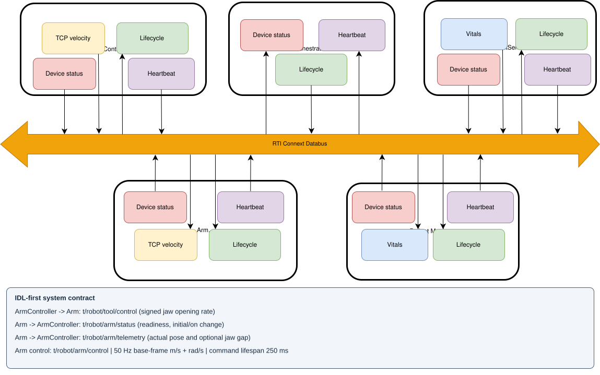

# Module 01: Digital Operating Room

Module 01 simulates a Digital Operating Room.

The applications have been tested to work in Debian-based environments with a GUI, including those in [WSL2 with GUI support](https://learn.microsoft.com/en-us/windows/wsl/tutorials/gui-apps#install-support-for-linux-gui-apps) (Windows 10 and 11), as well as on macOS.

All run commands in this README are launched from the repository root. The project-level `medtech.py run` script is the runtime entrypoint; there is no module-local launcher in this folder.

## Contents

- [Module Description](#module-description)
- [Setup and Installation](#setup-and-installation)
- [Run the Demo](#run-the-demo)
- [Hands-On: Going Further](#hands-on-going-further)
- [Next Steps](#next-steps)

## Module Description

This module implements five logical Connext applications using the MedTech Reference Architecture to simulate a digital operating room. The Arm Controller has optional Xbox/gamepad and Falcon variants; the Arm has an optional Kortex variant. Experimental physical-device variants require separate authorization and dependencies. You can find a diagram below:



### Patient Sensor

The *Patient Sensor* application's primary function is to publish simulated patient vitals data on Topic `t/patient/vitals`.

It has no user interface.

### Patient Monitor

The *Patient Monitor* application's primary function is to subscribe to simulated patient vitals data on Topic `t/patient/vitals`. Its XML content filter selects `ab1234` by default. Set `MEDTECH_PATIENT_ID` before launching to select another ID (1–8 UTF-8 bytes, without NUL or apostrophes); the built-in sensor still publishes `ab1234`. The filter cannot authenticate a source or distinguish a different patient from a silent stream.

The RTI Demo UI browser frontend displays synthetic ECG, plethysmograph, and capnography waveforms with numeric vital readouts.
The sensor normally writes approximately once per second. The Vitals QoS profile
sets a two-second offered and requested Deadline and a two-second writer
Lifespan. Deadline marks previously observed data quiet on a missed update;
Lifespan expires queued samples, not copies already displayed by the UI. A
non-alive instance also marks observed data quiet. Until a selected sample is
processed, the monitor remains waiting. The monitor rejects oxygen saturation
over 100% and blood pressure with diastolic greater than systolic. On START, the
monitor discards samples already in the reader cache and waits for another
sample. This drain is not an atomic reception or remote-generation boundary.
Invalid data is reported until another sample or a Deadline miss.

Deadline and Lifespan do not provide an atomic order between a miss and a
sample at the expiration boundary. Default reader Lifespan is reception-based,
and forwarded or replayed data can receive a new local validity window. This
demo indication is not an end-to-end freshness or safety guarantee.
These checks are demo data validation, not clinical alarms.

### Arm

The default *Arm* application simulates a six-axis articulated arm with fixed-length
links, a spherical wrist, an oriented TCP, and parallel jaws. It integrates
base-frame velocity on `t/robot/arm/control` and signed jaw-opening rate on
`t/robot/tool/control`, using lightweight FK/IK with joint/reach limits.

The existing RTI Demo UI Scene3D renderer displays an original articulated GLB
with persistent orbit/zoom and observed pose/gap readouts. Its connection badge
indicates a matched arm-control DDS writer, not a physical Xbox connection.
Readiness is separate from connectivity and generic device lifecycle.
The separately selected `kortex` variant adds a software-gated,
experimental Kortex motion path; see its stop limitations and operating
requirements in [Arm and controller](ARM_AND_CONTROLLER.md#experimental-kinova-motion-arm).

### Arm Controller

The simulated and Xbox *Arm Controller* variants publish complete arm/tool rate streams at 50 Hz,
including zeros while idle, and display actual arm readiness and telemetry.

The C++ frontend provides six base-frame translation/rotation controls, signed
jaw controls, and run/stop demonstration motion. The Xbox adapter maps sticks,
triggers, bumpers, and buttons to the same hardware-independent data model.
Neither controller predicts actual arm execution from its own command state.
The separately selected `falcon` variant publishes experimental
deadman-held translation commands; see its workspace and validation limits in
[Arm and controller](ARM_AND_CONTROLLER.md#experimental-falcon-motion-controller).
The [hardware check](ARM_AND_CONTROLLER.md#staged-rehearsal-and-physical-checks)
reports device state without DDS or motion commands.

For controller behavior and the arm command contract, see [Arm and controller](ARM_AND_CONTROLLER.md).

### Orchestrator

The *Orchestrator* application primarily acts as a system application state observer and controller. It detects the presence and current status of other system applications on Topics `t/device/heartbeat` and `t/device/status`, respectively. It can also command device-level actions, such as "Start" or "Shut Down" on Topic `t/device/command`.

The RTI Demo UI frontend displays each device's last reported lifecycle and
readiness separately from heartbeat presence, presents buttons to administer
device commands, and shows an activity stream of observed events. Readiness
describes the device's primary role: arm motion, controller input and command
publication, sensor publication, or current patient-monitor vitals. A present
heartbeat does not establish that last reported status is current or that the
device is healthy.

All graphical apps serve the same local web frontend. Browser mode is the
default; `--ui-mode native` opens that frontend in the RTI Demo UI embedded
webview rather than changing its renderer to native widgets.

Each application constructs its DDS entities in its `App` constructor and
explicitly enables its participant in `run()`; the XML participant-factory QoS
controls whether entities are already enabled. GUI entry points configure the
UI before running application work on C++ threads or Python asyncio tasks.
The headless Patient Sensor runs directly from `main()`.

## Setup and Installation

Complete the shared [Quick start](../../README.md#quick-start). If using
security, also prepare a [local or EPS bundle](../../README.md#security).

Module-specific notes:

- Use the [project launcher](../../docs/CLI.md) from the repository root.
- The Xbox/gamepad variant is optional at runtime. Its Pygame Community Edition dependency is included in the root `user` profile or the `gamepad` capability.
- Native webview mode is optional. Follow the [platform setup and build options](../../docs/SETUP.md) before selecting `--ui-mode native`.
- In native mode, the C++ System Orchestrator opens at 1600x950 and the Arm Controller at 1400x900; both windows remain resizable.

## Run the Demo

> Run the commands below from the repository root. If the Quick start is
> already running, skip to [Observe the application behavior](#2-observe-the-application-behavior).

### 1. Launch the applications

Run operating room applications from the repository root:

```bash
# From the repository root
python medtech.py run --scenario or-all
```

Open the local URL printed by each graphical app. To use an embedded desktop
webview instead of an external browser, add `--ui-mode native`.

To run with security enabled after preparing credentials:

```bash
# From the repository root
python medtech.py run --scenario or-all --security
```

*This script does the following:*

1. Set `NDDS_QOS_PROFILES` environment variable to load the appropriate XML configuration files (QoS Profiles, Domains, DomainParticipants).

2. Launch the application executables.

*Launch individual apps by logical name, e.g. `python medtech.py run 01-operating-room Arm PatientMonitor`. See [module.toml](./module.toml) for app roles, variant choices, and QoS configuration.*

### 2. Observe the application behavior

1. In **Orchestrator**, check which devices are online. In **Patient Monitor**,
   check that synthetic vitals are updating.
2. Select **Patient Sensor** in Orchestrator and send **PAUSE**, then **START**.
   The vitals stream pauses and resumes without the sensor leaving the system.
   If you already did this in Quick Start, continue with the arm.

#### Try the arm controller

Select **RUN DEMO** in **Arm Controller**. Compare the commanded motion with
the observed pose in **Surgical Arm Monitor**, then select **STOP MOTION**.

Expand **DDS topics** in either app's header. An orange ↑ marks a configured
publisher and a blue ↓ marks a configured subscriber. This is a topic map,
not a live traffic indicator. The lock reports whether the local participant
has DDS Security enabled, not whether peers have authenticated it. A dash means
no active participant status is available.

#### What DDS is doing

- The sensor publishes vitals separately from device heartbeats. See [cadence,
  liveliness, and device presence](../../system/README.md#separate-data-cadence-writer-liveliness-and-device-presence).
- The controller publishes motion intent; the arm publishes observed state.
  See [why state and commands use different QoS](../../system/README.md#give-late-joiners-state-not-old-commands).

### 3. Stop or continue

Press `Ctrl-C` in the launcher terminal to stop all apps. Closing a browser tab
does not stop its app process.

**Next → [Module 02: Record and replay](../02-record-playback/README.md#run-the-demo).**

## Optional controller and simulation reference

See [Arm and controller](ARM_AND_CONTROLLER.md) for gamepad controls, command validity, feedback, and simulation details.

### Optional demo variations

- From the *Arm Controller*, hold translation and rotation controls to move the TCP in all six base-frame components, and hold jaw controls to open/close the tool. Release to zero the rate. "RUN DEMO" and "STOP MOTION" start/stop a bounded motion/tool sequence. Rotate the tool, then command +Z translation: it still moves upward in the base frame, not along the shaft. Compare observed feedback in the controller and Arm views.
- Ungracefully terminate the *Arm* application process. Observe the effect in the *Orchestrator* activity stream.
- Initiate a graceful remote shutdown of the *Arm Controller* by sending the appropriate command from the *Orchestrator*. Observe the effect of the *Arm Controller* application.

## Hands-On: Going Further

Here are a few hands-on exercises to demonstrate use cases of Connext features in this module.

### 1. Application Presence Detection

The *t/device/heartbeat* writers and readers use a 200 ms ***Deadline QoS***
period. Each application derives its heartbeat interval from the writer's
offered deadline, publishing every third of the period (about 67 ms with the
current profile). This leaves margin for occasional best-effort sample loss.
When the reader reports a missed deadline, the Orchestrator reconciles each
known device's most recent reception timestamp against the deadline before
logging a presence transition:

```text
PATIENT_MONITOR stopped sending heartbeats; presence OFFLINE
```

The Orchestrator monitors heartbeat presence asynchronously with an AsyncWaitSet:
a requested-deadline-missed StatusCondition detects loss, and a ReadCondition
handles heartbeat arrivals and instance-lifecycle notifications.
The Python publishers run as separate asyncio tasks, not separate threads:
blocking work on the event loop can delay their heartbeats.

Let's try testing how modifying QoS Profiles can adjust system behavior without modifying any application logic.

1. Kill all active operating room applications.

2. Add a reader-only Deadline override to the *DataFlowLibrary::Heartbeat*
   profile in [Qos.xml](../../system/qos/Qos.xml):

   *Note, you should undo this configuration change after completing this demonstration.*

   ```xml
   <datareader_qos>
     <deadline>
       <period>
         <sec>5</sec>
         <nanosec>0</nanosec>
       </period>
     </deadline>
   </datareader_qos>
   ```

3. Relaunch the operating room applications.

4. While monitoring the *Orchestrator* "Alerts" panel, ungracefully terminate
   the *Patient Monitor* process (for example, `kill -9 <pid>` on Linux or
   macOS). Closing its browser tab does not stop the process.

   > [!NOTE]
   > **Observe:** You should see the alert mentioned above logged approximately
   > 5 seconds after the last Patient Monitor heartbeat.

5. Undo the QoS change to revert to the recommended configuration.

### 2. Content Filters

The module uses Content-Filtered Topics for DataReaders in all applications that subscribe to the *t/device/command* Topic. This allows the *Orchestrator* application to use a single Topic to publish device-specific commands. This allows the subscribing application logic to not have to check if the device command is relevant before processing it.

For example, the *Patient Monitor* application uses a `device = 'PATIENT_MONITOR'` filter expression for its DataReader subscribed to the *t/device/command* Topic.

Let's try testing how removing a content filter can adjust system behavior without modifying any application logic.

1. Kill all active operating room applications.

2. Comment out the `<content_filter>` tag and contained content within it, for *dr/DeviceCommand* under *dp/PatientMonitor* in [ParticipantLibrary.xml](../../system/model/ParticipantLibrary.xml).

   *Note, you should undo this configuration change after completing this demonstration.*

3. Relaunch the operating room applications.

4. While monitoring both the *Arm Controller* and *Patient Monitor* application windows, send a "Shut Down" command from the *Orchestrator* application **for the *Arm Controller* application only**.

   > [!NOTE]
   > **Observe:** Both the *Arm Controller* and *Patient Monitor* applications shut down and exit.

   Without its filter, the *Patient Monitor* receives commands intended for any app.

5. Undo the Content Filter change to revert to the recommended configuration.

## Next Steps

Check out [Module 02: RTI Recording Service & RTI Replay Service](../02-record-playback/), which builds upon the applications from this module to show how data can be recorded from and replayed to the same applications.

Check out [Module 03: Remote Teleoperation with RTI Real-Time WAN Transport](../03-remote-teleoperation/), which builds upon the applications from this module to show how applications can be deployed remotely and integrate seamlessly over the Wide Area Network (WAN).

To trace these flows in the source, go directly to the [DDS contract](../../system/README.md#dds-contract). For a prepared demo, use the [operator run card](../../docs/OPERATOR.md).
