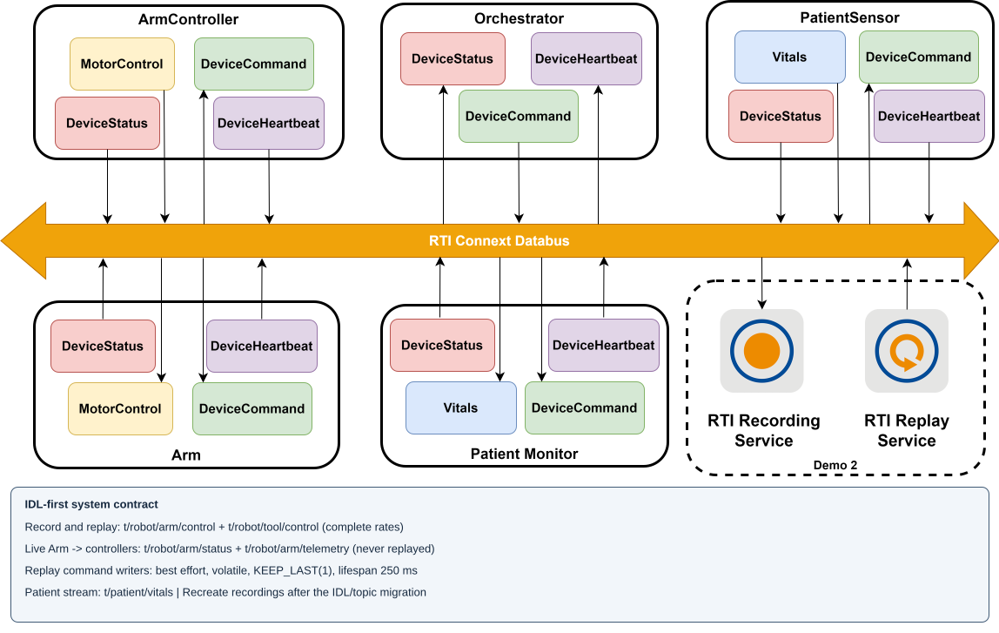

# Module 02: RTI Recording Service & RTI Replay Service

Module 02 demonstrates recording and playback of Digital Operating Room data from [Module 01: Digital Operating Room](../01-operating-room/).

RTI Recording Service is used to record realtime DDS data on the following Topics:

- *t/robot/arm/control*
- *t/robot/tool/control*
- *t/patient/vitals*

RTI Replay Service is used to play back the recorded data to the Arm and Patient Monitor GUI applications, simulating live data.

Arm and tool commands are periodic velocity/rate streams using
`DataFlowLibrary::Control`, not reliable one-shot commands. Replay output writers
have the same 250 ms lifespan as live controllers. The Arm publishes its own
observed readiness/telemetry; these are deliberately not replayed as competing
truth. Playback timing matters: changing rate or introducing gaps can change the
path, jaw travel, and expiry behavior. This is not trajectory-invariant playback.
Recreate recordings after this breaking IDL/topic migration; old recordings are
not converted.

This module reuses the operating room applications from [Module 01](../01-operating-room/). Those applications have been tested to work in Debian-based environments with a GUI, including those in [WSL2 with GUI support](https://learn.microsoft.com/en-us/windows/wsl/tutorials/gui-apps#install-support-for-linux-gui-apps).

RTI Recording Service and RTI Replay Service can be run on any [officially supported platform](https://community.rti.com/static/documentation/connext-dds/7.7.0/doc/manuals/connext_dds_professional/release_notes/pam_table.html#rti-infrastructure-services), provided the machine is directly discoverable by the machine the operating room applications are launched from.

All run commands in this README are launched from the repository root. The project-level `medtech.py run` script is the runtime entrypoint; there is no module-local launcher in this folder.

## Contents

- [Module Description](#module-description)
- [Setup and Installation](#setup-and-installation)
- [Run the Demo](#run-the-demo)
- [Hands-On: Going Further](#hands-on-going-further)
- [Next Steps](#next-steps)

## Module Description

This module uses RTI Recording Service to record data from the operating room applications from Module 01. It then uses RTI Replay Service to replay the recorded data back to the same OR applications. Please find a diagram of how Recording / Replay Service connect to the RTI Connext Databus below:



### RTI Recording Service

RTI Recording Service records `t/robot/arm/control`, `t/robot/tool/control`, and
`t/patient/vitals` from [Module 01](../01-operating-room/).

### RTI Replay Service

RTI Replay Service republishes the same three recorded streams to the live
Arm and Patient Monitor. With the command streams quiet, the Arm holds its
current pose/gap when cached rates expire, rather than automatically opening
the tool. See [command validity](../../system/DDS_DESIGN_GUIDE.md#rate-command-validity).

## Setup and Installation

Complete the shared setup in the root [Quick Start](../../README.md#quick-start) section. This module reuses the operating room applications from Module 01, so make sure that workflow is built and working before you start record/playback.

For secure runs, prepare a [local bundle](../../system/security/README.md) or
follow the [EPS recording and replay setup](../../docs/EPS.md#module-02-record-and-replay).

Module-specific notes:

- If you plan to use secure mode, make sure the security artifacts from the root README have been generated.

## Run the Demo

> Important: Run the commands below from the repository root. `medtech.py run` lives at the project root and is the single runtime entrypoint for this project.
>
> Tip: the predefined `record` and `replay` scenarios bundle the operating room apps and the corresponding service into a single command (e.g. `python medtech.py run --scenario record`). The step-by-step flow below instead runs them in separate terminals so you can start and stop the service independently of the OR apps. Run `python medtech.py run --list-scenarios` to see all scenarios.

### 1. Run Operating Room Applications

In its own terminal, launch the operating room applications from [Module 01](../01-operating-room/README.md#run-the-demo) using the project-level launcher (use `-s` option for security):

```bash
# From the repository root
python medtech.py run 01-operating-room [-s]
```

### 2. Run RTI Recording Service

In a new terminal, launch RTI Recording Service from the repository root (use `-s` option for security):

```bash
# From the repository root
python medtech.py run 02-record-playback RecordingService [-s]
```

Let RTI Recording Service run for some time (e.g. 10-20 seconds) before initiating shutdown with `Ctrl-C`.

> [!NOTE]
> **Observe:** Once finished, a new folder should be created - `or_recording` - containing the recording files.

#### Further Learning: Recording Service

Inspect [RecordingServiceConfiguration.xml](RecordingServiceConfiguration.xml) to understand how RTI Recording Service is configured to record DDS Topics.

### 3. Shutdown Operating Room Applications / Restart GUI Applications

Press `Ctrl-C` in the terminal where Module 01's `medtech.py run` is running to terminate the operating room applications.

Relaunch the Digital Operating Room Arm and Patient Monitor GUI applications only (use `-s` option for security):

```bash
# From the repository root
python medtech.py run 01-operating-room Arm PatientMonitor [-s]
```

> [!NOTE]
> **Observe:** You should see the GUI applications are not receiving data.

### 4. Run RTI Replay Service

In a new terminal, launch RTI Replay Service from the repository root (use `-s` option for security):

```bash
# From the repository root
python medtech.py run 02-record-playback ReplayService [-s]
```

> [!NOTE]
> **Observe:** You should see the Arm and Patient Monitor applications are receiving data previously recorded.

The Replay Service configuration has `<enable_looping>` set to `true`, so the replay will start over when it reaches the end of the recording.

### 5. Kill the applications

Press `Ctrl-C` in each terminal to terminate the running applications.

#### Further Learning: Replay Service

Inspect [ReplayServiceConfiguration.xml](ReplayServiceConfiguration.xml) to understand how RTI Replay Service is configured to replay recorded DDS Topics.

## Hands-On: Going Further

Here are a few hands-on exercises to demonstrate use cases of Connext features in this module.

### 1. Selecting Topics for Replay

The module records and replays `t/robot/arm/control`, `t/robot/tool/control`,
and `t/patient/vitals` on Domain 0. Both services can be configured with
explicit Topics or discovered Topics/Data Types that match a pattern.

The vitals recording reader and replay writer use the shared Vitals QoS profile.
Replay offers the same Deadline and Lifespan as the live sensor; gaps in recorded
data can still cause the monitor to report a missed Deadline. Replay establishes
a new local reception window rather than proving original measurement freshness.

Let's replay only `t/patient/vitals` from an existing recording.

1. Kill all active operating room applications and RTI Recording/Replay Services.

2. Comment out the `<topic>` elements for `t/robot/arm/control` and
   `t/robot/tool/control` in [ReplayServiceConfiguration.xml](./ReplayServiceConfiguration.xml).

   *Note, you should undo this configuration change after completing this demonstration.*

3. Relaunch the operating room *Arm* and *Patient Monitor* applications.
   While monitoring their GUIs, start RTI Replay Service.

   > [!NOTE]
   > **Observe:** The *Patient Monitor* receives data, but *Arm* shows no motor movement.

4. Restore the replay configuration after the exercise.

### 2. RTI Admin Console

[RTI Admin Console](https://community.rti.com/static/documentation/connext-dds/7.7.0/doc/manuals/connext_dds_professional/tools/admin_console/index.html) is a troubleshooting tool that includes handy integrations for RTI Recording Service and RTI Replay Service. This module configures both RTI Recording Service and RTI Replay Service to allow for "administration" capabilities on Domain 99.

Let's try using RTI Admin Console to administer RTI Recording Service.

1. Launch RTI Admin Console.

   - From RTI Launcher:
        1. Open *RTI Launcher*.
        2. Navigate to the **Tools** tab.
        3. Click the *Admin Console* button.
   - From a terminal:
        1. Launch the `rtiadminconsole[.bat]` script found in the *$NDDSHOME/bin* folder. *Where *$NDDSHOME* is the folder where Connext is installed.*

2. In RTI Admin Console, join Domains 0 (Operational Data) and 99 (RTI Recording Service Administration).

    1. In RTI Admin Console toolbar, go to "View" > "Preferences".
    2. In the preferences popup, ensure you have the "Administration" tab selected in the sidebar.
    3. In the popup's main panel, select the "Manually join and leave domains" radio button.
    4. In next field, "Please specify the domains to be joined", enter `0,99`.
    5. Click "Apply and Close" in the Preferences popup.

3. Launch the operating room applications and RTI Recording Service.

4. In RTI Admin Console, go to the "Physical View" and select the RTI Recording Service process.

    1. In RTI Admin Console toolbar, go to "View" and check if an option "Show Physical Tree View" exists - if so, click it. If instead, you see "Hide Physical Tree View", find the Physical Tree view panel already open.
    2. Expand the "System" tree two levels ("System", \<hostname>).
    3. Select `RecServCfg`.

5. In RTI Admin Console main panel, view RTI Recording Service statuses and available commands.

6. Remotely shut down RTI Recording Service.

    1. From RTI Admin Console, while viewing the RTI Recording Service process, click the "Shutdown" button to stop and kill the RTI Recording Service process.
    2. Confirm in the popup that you would like to shut down the service.

   > [!NOTE]
   > **Observe:** The RTI Recording Service process stops gracefully in its launch terminal.

## Next Steps

**Next → [Module 03: Remote teleoperation](../03-remote-teleoperation/).**

To trace the recorded and replayed data back to its types and endpoints, see
the [DDS contract](../../system/README.md#dds-contract).
