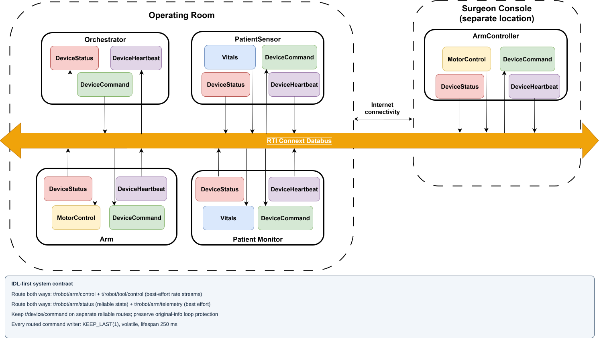
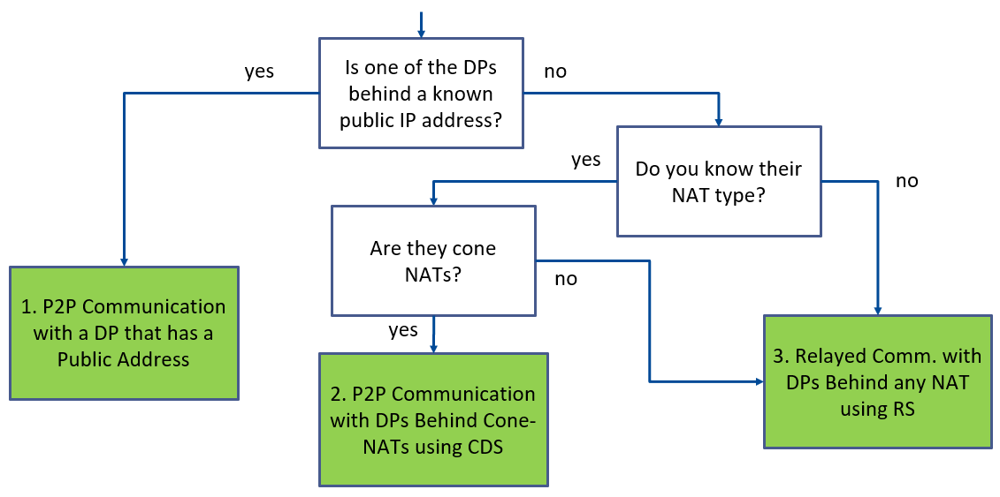

# Module 03: Remote Teleoperation with RTI Real-Time WAN Transport

Module 03 demonstrates remote teleoperation across the Wide Area Network (WAN) using the RTI Real-Time WAN Transport. This transport plugin enables DDS communication across the WAN using UDP as the underlying transport-layer protocol.

This module shows how the *ArmController* from [Module 01: Digital Operating Room](../01-operating-room/) can communicate with the rest of the simulated system over a configured WAN. Be sure you are able to run the operating room application from Module 01 before trying out this module's demo.

All run commands in this README are launched from the repository root. The project-level `medtech.py run` script is the runtime entrypoint; there is no module-local launcher in this folder.

The routes separate best-effort arm/jaw rates
(`t/robot/arm/control`, `t/robot/tool/control`) from reliable device lifecycle
commands. They also carry arm readiness (`t/robot/arm/status`, reliable
transient-local) and periodic observed feedback (`t/robot/arm/telemetry`, best
effort), alongside the existing device and patient flows. Every routed command
writer uses `DataFlowLibrary::Control`, including its 250 ms lifespan and
compatible diagnostic deadline. Reliable route readers would not match the
best-effort controller writers.

Original-info/loop-prevention behavior is retained. Lifespan is a local
reception-based validity window, not a guarantee of source-to-actuator command
age across WAN hops. Connectivity recovery admits current valid rates without
a neutral/rearm latch. This demonstration is not a physical teleoperation safety
system; see the [shared contract](../../system/DDS_DESIGN_GUIDE.md#rate-command-validity).

## Contents

- [Module Description](#module-description)
- [Setup and Installation](#setup-and-installation)
- [Run the Demo](#run-the-demo)
- [Hands-On: Going Further](#hands-on-going-further)
- [Next Steps](#next-steps)

## Module Description

This module extends the simulated Digital Operating Room from Module 01 to demonstrate WAN communication. Connectivity, security and delivery behavior depend on the selected scenario and endpoint configuration; the demo does not establish a clinical teleoperation or timing guarantee.

RTI Connext abstracts the underlying transport, such that the api usage and much of the configuration can remain consistent regardless of which transport is used. This is true for the Real-Time WAN Transport, and this module shows that the same applications communicating locally can be extended to work over a remote connection without modification to application code. The WAN deployment does select a WAN-specific transport profile and, when security is enabled, a stricter WAN governance (see below), but the application logic itself is unchanged.



WAN communication can be deployed in 3 different scenarios:

1. [Scenario 1](Scenario1.md): Direct Peer-to-Peer Communication with Public IP Address.
2. [Scenario 2](Scenario2.md): Direct Peer-to-Peer Communication Using [RTI Cloud Discovery Service](https://community.rti.com/static/documentation/connext-dds/7.7.0/doc/manuals/addon_products/cloud_discovery_service/index.html).
3. [Scenario 3](Scenario3.md): Relayed Communication Using [RTI Routing Service](https://community.rti.com/static/documentation/connext-dds/7.7.0/doc/manuals/connext_dds_professional/services/routing_service/index.html).

The heartbeat and status routes forward the device key and payload under the Routing Service writer's own identity (`publish_with_original_info=false`). The applications track devices by key, not by the originating writer GUID, so these routes do not need Security proxy permissions.

### RTI Real-Time WAN Transport

The RTI Real-Time WAN Transport extends Connext's UDP-based communication to support Network Address Translation (NAT) traversal scenarios - a foundational piece to the scalability and security of the Wide Area Network.
The Real-Time WAN Transport enables direct peer-to-peer DDS communication across the WAN, leveraging UDP as an underlying transport for lower latency and higher throughput.

Together, the RTI Real-Time WAN Transport, RTI Security Plugins, and RTI Cloud Discovery Service, offer a robust solution that provides:

- **UDP-based communication** across WAN connections; latency depends on the network and configuration
- **Automatic NAT traversal** capabilities
- **Configurable data protection** when security is enabled: WAN *TeleopWanDomain* governance encrypts RTPS messages and applies metadata encryption to every topic; LAN *OperationalDomain* applies metadata encryption to patient vitals and the four robot control/status/telemetry topics.
- **Connection recovery** when discovery and network conditions permit

## Setup and Installation

Complete the shared setup in the root [Quick Start](../../README.md#quick-start) section. This module adds WAN-specific prerequisites that the scenario pages cover in detail.

The scenarios describe the default local provider. For EPS, use their transport
setup with the [EPS LAN/WAN enrollment and launch guide](../../docs/EPS.md#module-03-remote-teleoperation).

## Run the Demo

> Important: The commands below are run from the repository root using the project-level `medtech.py run` script.

For this module, you will need the following:

1. Two machines connected to the WAN (not on the same LAN) that can run the operating room applications from Module 01.
2. Conditionally, a cloud instance that is publicly reachable by both machines noted above. *This is required for Scenarios 2 and 3 described below.*

### 1. Determine Your Scenario

Refer to the following decision tree to understand which scenario best suits your environment:



To determine your NAT type, use the [NAT type checker](../../tools/nat_type_checker/) script on *each* remote machine:

```bash
python3 tools/nat_type_checker/nat_type_checker.py
```

### 2. Run Your Scenario

Select the appropriate scenario based on your network configuration:

- #### Scenario 1 - Direct Peer-to-Peer Communication with Public IP Address

  **Use if either machine is directly reachable at a public IP address.**

  Follow the detailed instructions in [Scenario1.md](Scenario1.md) to set up peer-to-peer communication with a public IP address.

- #### Scenario 2 - Direct Peer-to-Peer Communication Using RTI Cloud Discovery Service

  **Use if either machine is reachable behind a Cone NAT.**

  Follow the detailed instructions in [Scenario2.md](Scenario2.md) to set up communication using RTI Cloud Discovery Service for NAT traversal.

- #### Scenario 3 - Relayed Communication Using RTI Routing Service

  **Use if none of the scenarios above apply or you are unsure of your setup.**

  Follow the detailed instructions in [Scenario3.md](Scenario3.md) to set up relayed communication using RTI Routing Service.

## Hands-On: Going Further

Here is a hands-on exercise to explore WAN communication features and demonstrate RTI Connext capabilities across distributed networks.

### Connection Resilience

Test how the system handles network interruptions.

1. Run your chosen scenario and establish WAN communication.

2. Temporarily disconnect the network connection (e.g., disable WiFi).

3. Reconnect after 10-30 seconds.

   >**Observe:** DDS discovery across the WAN using the Real-Time WAN Transport should allow automatic reconnection and resume data flow without application-level intervention.

## Next Steps

**Next → [Module 04: DDS Security demonstration](../04-security-threat/).**

To understand why routing and authorization are separate concerns, see
[traffic boundaries and access control](../../system/README.md#separate-traffic-boundaries-from-access-control).
