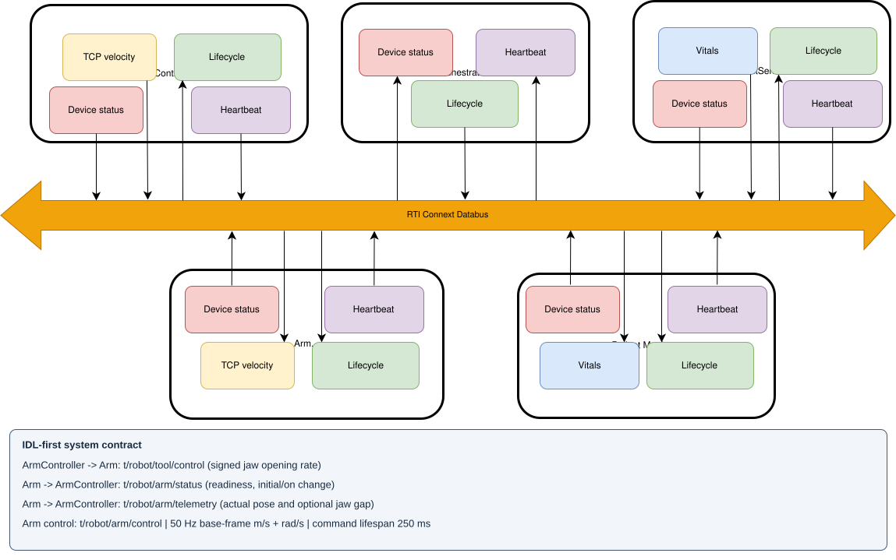

# MedTech system architecture

The system definition connects the demo applications through shared DDS types, topics, QoS, entities, and security rules.

## DDS contract

Trace a data path in this order:

| Question | Authoritative source |
| --- | --- |
| What is on the wire? | [IDL](./idl/MedTech.idl) and the [domain/topic library](./model/DomainLibrary.xml) |
| Who creates readers, writers and filters? | [Participant library](./model/ParticipantLibrary.xml) and [operating-room application code](../modules/01-operating-room/src/) |
| What guarantees apply? | [QoS profiles and snippets](./qos/README.md) |
| Who may join, publish and subscribe? | [Governance, role permissions and runtime bundles](./security/README.md) |
| What crosses a boundary or survives replay? | [Routing and WAN](../modules/03-remote-teleoperation/), [recording and replay](../modules/02-record-playback/) |

For example, the Arm Controller publishes motion intent, while the Arm
publishes observed state independently. Follow the
[arm topic contract](../modules/01-operating-room/ARM_AND_CONTROLLER.md#arm-model-command-validity-and-observed-feedback)
before changing rate, frame, lifespan or permissions. The browser and
simulation are consumers of the architecture, not definitions of the DDS wire
contract.

### Reusable DDS guidance

These examples use Connext DDS 7.7.0. **DDS concept** describes middleware
behavior; **Best practice** callouts describe what to carry over when the
requirements fit; **In this project** explains the choice and where to find
the working example. The example settings are not production defaults.

#### Share one data model across C++ and Python

**DDS concept:** IDL defines types, keys, bounds, and extensibility independently
of the language that reads or writes the data.

> [!TIP]
> **Best practice:** Keep one canonical IDL contract. When evolving it,
> check both wire compatibility and whether the fields still mean the same thing.

**In this project:** [MedTech.idl](idl/MedTech.idl) defines the shared types.
[CMake code generation](CMakeLists.txt) shows `connextdds_rtiddsgen_run`,
including the `refArchTypes` target for C++. The demo generates Python bindings
and XML from the same IDL rather than maintaining parallel type definitions.

#### Give late joiners state, not old commands

**DDS concept:** A key identifies an instance. `TRANSIENT_LOCAL` can provide
retained writer history to late joiners while the writer exists; it does not
persist data across writer restarts. `VOLATILE` does not provide late-join
history, and does not by itself expire a sample.

> [!TIP]
> **Best practice:** Separate state from transient commands when their
> freshness and delivery requirements differ. Bound command validity at the
> consumer; DDS Lifespan alone does not stop application behavior based on a
> sample already taken.

**In this project:** See `dp/Arm` in the [participant library](model/ParticipantLibrary.xml)
and the `DataFlowLibrary::Status` and `DataFlowLibrary::Control` profiles in
[Qos.xml](qos/Qos.xml) for the separation between motion intent and observed
state. The [arm command contract](DDS_DESIGN_GUIDE.md#rate-command-validity)
explains the demo's expiry and idle behavior; choose timing and stop behavior
for your system rather than copying the demo settings.

#### Separate data cadence, writer liveliness, and device presence

**DDS concept:** Deadline expresses expected updates per instance; Liveliness
tracks the writer's liveliness lease. Neither guarantees the device is healthy.

> [!TIP]
> **Best practice:** Use the signal that answers your question. Add an
> application heartbeat when you need an application-defined presence or health
> signal beyond writer liveliness. Document what it does and does not prove.

**In this project:** [HeartbeatPresence.hpp](../modules/01-operating-room/src/HeartbeatPresence.hpp)
shows how the Orchestrator handles keyed heartbeats and Deadline changes with
C++ `AsyncWaitSet`. Vitals can pause while the sensor continues reporting
presence. That presence signal does not certify sensor or control-loop health.

#### Load named XML QoS and choose when to enable entities

**DDS concept:** Named profiles and snippets configure reusable QoS; entity
factory settings control auto-enable.

> [!TIP]
> **Best practice:** Keep shared QoS reviewable in named XML profiles.
> Use explicit enable when startup sequencing matters, not as a requirement for
> every app.

**In this project:** [Qos.xml](qos/Qos.xml) composes `Streaming` and `Control`;
[ApplicationFactoryQos.xml](qos/ApplicationFactoryQos.xml) sets the startup
policy. [Orchestrator.cxx](../modules/01-operating-room/src/Orchestrator.cxx)
shows `participant_.enable()` after early setup and handler registration.

#### Receive data without coupling DDS to the UI

**DDS concept:** C++ `AsyncWaitSet` dispatches triggered conditions on worker
threads; Python can use `take_data_async()` or an asyncio-compatible `WaitSet`.
Neither changes reliability, history, or publication mode.

> [!TIP]
> **Best practice:** Choose a receive mechanism that fits the app's
> concurrency model, and keep receive handlers focused so rendering or other
> slow work does not delay DDS handling.

**In this project:** Compare the C++ condition handlers in
[HeartbeatPresence.hpp](../modules/01-operating-room/src/HeartbeatPresence.hpp)
with the Python vitals loop in
[PatientMonitor.py](../modules/01-operating-room/src/PatientMonitor.py), which
handles data and Deadline notifications together.

#### Separate traffic boundaries from access control

**DDS concept:** Domains separate DDS traffic; DDS Security uses governance
and permissions to enforce access and protection policy.

> [!TIP]
> **Best practice:** Grant each role only the access it needs. Treat
> separate domains as a topology choice, not a substitute for authorization.

**In this project:** The [security guide](security/README.md) explains the
local policies and role grants. The [WAN module](../modules/03-remote-teleoperation/)
shows how Routing Service participates on both sides of the boundary.

## Explore further

- [DDS design guide](DDS_DESIGN_GUIDE.md): concepts, design choices, and source-backed recommendations.
- [DDS model](model/README.md): XML application creation, domains, and participants.
- [QoS profiles](qos/README.md): data-flow profiles and detailed configuration.
- [DDS Security](security/README.md): governance, permissions, and provisioning.
